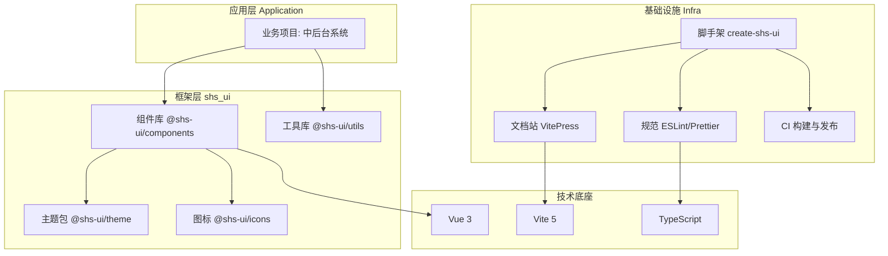

# shs\_ui 前端框架设计文档

> 版本：v0.2（已评审确认）
> 状态：已确认 —— 评审已通过，进入 M1 工程搭建阶段


***

## 1. 项目概述

### 1.1 定位

**shs\_ui** 是一个基于 **Vue 3** 的企业级前端 UI 框架，包含两部分：


* **组件库**（@shs-ui/components）：可复用的基础与业务组件；

* **工程脚手架**（create-shs-ui）：统一的工程化基础设施（构建、规范、测试、文档）。

目标：让团队以「一套设计规范 + 一套组件 + 一套工程约定」快速搭建中后台产品，避免重复造轮子，保证多项目视觉与代码风格一致。

### 1.2 命名


* 包名：`shs_ui` 作为仓库名；发布到 npm 时统一使用 `@shs-ui/*` 作用域（scoped）命名。

* 组件前缀：`SHS`（如 `<shs-button>`、`<shs-table>`），避免与原生标签及第三方库冲突。

### 1.3 目标（非目标）


| 目标                 | 非目标                          |
| ------------------ | ---------------------------- |
| 面向中后台 / 管理端场景的基础组件 | 不追求成为通用全场景组件库（如电商、C 端营销）     |
| 支持按需引入与全量引入两种模式    | 不做移动端专项适配（内部以桌面端为主）          |
| 完善的类型提示与单元测试       | 初期不提供复杂可视化图表组件（引入第三方按需封装）    |
| 可定制的主题与暗色模式        | 不依赖运行时 JSON Schema 动态表单（可后置） |


***

## 2. 技术选型


| 领域    | 选型                                          | 理由                           |
| ----- | ------------------------------------------- | ---------------------------- |
| 运行时框架 | **Vue 3.4+（**`<script setup>`**）**          | 组合式 API、性能与生态成熟              |
| 构建工具  | **Vite 5**                                  | 开发热更新快，库模式（lib mode）打包友好     |
| 开发语言  | **TypeScript 5**                            | 组件 Props/Emits 类型推导，IDE 提示完整 |
| 样式方案  | **SCSS + CSS 变量（设计令牌）**                     | 主题可运行时切换，暗色模式低成本             |
| 包管理   | **pnpm**                                    | monorepo 依赖管理与软链高效           |
| 单元测试  | **Vitest + @vue/test-utils**                | 与 Vite 同构，启动快                |
| 代码规范  | **ESLint 9 + Prettier + husky/lint-staged** | 统一代码风格，提交前自动校验               |
| 文档站   | **VitePress**                               | Vue 官方文档方案，组件示例 + API 自动生成   |
| 发布    | **Changesets + npm**                        | 规范化的 semver 版本管理与 changelog  |
| 仓库组织  | **pnpm workspace（monorepo）**                | 组件 / 文档 / 脚手架同仓维护            |


***

## 3. 整体架构




**分层原则**：


* 组件库不依赖业务代码，只依赖工具库与主题；

* 工具库保持纯函数、零副作用，可单独发布使用；

* 主题以 CSS 变量形式独立成包，便于换肤。


***

## 4. 目录结构（monorepo）


```
shs\\\_ui/

├── packages/

│   ├── components/        # 组件库主包

│   │   ├── src/

│   │   │   ├── button/

│   │   │   ├── input/

│   │   │   ├── table/

│   │   │   └── ...

│   │   └── index.ts       # 统一导出

│   ├── theme/             # 设计令牌 / CSS 变量 / 暗色

│   ├── utils/             # 工具函数（判断、格式化、类型守卫）

│   ├── icons/             # 内置 SVG 图标

│   └── cli/               # create-shs-ui 脚手架

├── docs/                  # VitePress 文档站 + 组件示例

├── playground/            # 本地开发调试 Demo

├── .changeset/            # 版本发布配置

├── package.json

├── pnpm-workspace.yaml

└── tsconfig.json
```


***

## 5. 组件库设计

### 5.1 组件分层


| 层级   | 说明        | 示例                                           |
| ---- | --------- | -------------------------------------------- |
| 基础组件 | 高频通用原子组件  | Button、Input、Select、Table、Form、Modal、Message |
| 业务组件 | 中后台常用复合组件 | ProTable（带搜索 / 分页）、ProForm、UploadImage       |
| 展示组件 | 数据展示与反馈   | Tag、Badge、Empty、Result、Descriptions          |

### 5.2 命名与 API 规范


* 组件名：PascalCase 文件 + `SHS-` 前缀使用（`<shs-button>`）。

* 事件命名：统一 `update:modelValue` 作 v-model 绑定，其余事件用 onXxx 或自定义语义名。

* Props 定义：使用 `withDefaults` + 类型定义，运行时校验统一 `PropType`。

* 组件尺寸：统一 `size` 属性（`small | medium | large`，默认 `medium`）。

* 状态反馈：`disabled`、`loading`、`clearable` 等通用属性统一定义。

### 5.3 组件接入协议

每个组件目录统一结构，保证可维护性：


```
button/

├── button.vue         # 组件实现

├── props.ts           # Props 类型定义

├── style/index.scss   # 组件样式（引用主题变量）

├── \\\_\\\_tests\\\_\\\_/         # 单元测试

└── index.ts           # 组件导出 + install 注册
```


***

## 6. 主题与设计令牌


* 建立 **CSS 变量设计令牌**（Design Tokens）：颜色、间距、字号、圆角、阴影等全部变量化。

* 变量命名空间：`--shs-*`（如 `--shs-color-primary`、`--shs-radius-md`）。

* **暗色模式**：通过 `data-theme="dark"` 在根节点切换变量值，无需重写组件。

* 支持通过覆盖变量实现**品牌换肤**。


```
:root {

\&#x20; --shs-color-primary: #3b82f6;

\&#x20; --shs-radius-md: 8px;

}

\\\[data-theme="dark"] {

\&#x20; --shs-color-primary: #60a5fa;

}
```


***

## 7. 工程化体系

### 7.1 构建与产物


* 组件库使用 Vite **库模式**，输出：


  * `dist/es`（ESM，按需引入，配合 `sideEffects` 声明）；

  * `dist/lib`（UMD 全量）；

  * `dist/style.css`（主题样式）。

* 提供 `unplugin-vue-components` 的 **Resolver**，实现按需自动引入。

### 7.2 代码质量


* ESLint（vue + ts 规则集）+ Prettier 统一格式。

* husky + lint-staged：提交前自动校验与格式化。

* commitlint：`feat/fix/docs/refactor...` 规范化提交信息。

### 7.3 测试


* 单元测试：核心组件（Button/Input/Select/Table/Form）覆盖率目标 ≥ 80%。

* 视觉回归：关键组件基于主题变量的快照测试。

### 7.4 文档


* VitePress 提供：组件展示 Demo、Props/Emits/Slots API 表格、使用指南、主题说明。

* 组件 API 由类型定义自动提取，保证与源码一致。

### 7.5 发布


* Changesets 管理版本，遵循 **semver**：破坏性变更 → major，新增功能 → minor，修复 → patch。

* CI（GitHub Actions）：lint → test → build → publish 自动化流水线。


***

## 8. 开发路线图（里程碑）


| 阶段          | 内容                                                                                | 交付物               |
| ----------- | --------------------------------------------------------------------------------- | ----------------- |
| M1 工程搭建     | monorepo、构建、规范、CI、文档骨架                                                            | 可运行的仓库骨架          |
| M2 基础组件（一期） | Button、Icon、Tag、Input、Form、Select、Modal、Message、Table、Pagination、Card、Layout、Menu | 首批 13 个组件         |
| M3 复合组件     | Table、ProTable、ProForm、Upload、Tree、Tabs                                           | 覆盖中后台常用场景         |
| M4 完善与发布    | 暗色模式、主题文档、测试补全、npm 首版发布                                                           | `@shs-ui/*@1.0.0` |


***

## 9. 关键决策记录（ADR 摘要）


1. **用 pnpm monorepo 而非单仓**：多包独立发布、按需引入更灵活。

2. **样式走 CSS 变量而非运行时 JS 主题**：避免引入运行时注入开销，暗色 / 换肤更稳。

3. **组件前缀 SHS、作用域 @shs-ui**：隔离命名空间，规避冲突。

4. **按需引入为默认能力**：通过 Resolver 实现，兼顾打包体积与开发体验。


***

## 10. 已确认决策（评审结论）

评审已通过，确认结果如下：


1. **组件前缀** `SHS-`、包作用域 `@shs-ui/*` —— ✅ 认可

2. **技术栈** Vue 3.4 + Vite 5 + TypeScript + SCSS —— ✅ 确认

3. **M2 首期组件范围**：Button、Icon、Tag、Input、Form、Select、Modal、Message、**Table、Pagination、Card、Layout、Menu**（共 13 个）—— ✅ 确认

4. **暗色模式** 推迟至 M4 阶段再做，M2/M3 不实现 —— ✅ 确认

5. 文档站使用 **VitePress** —— ✅ 接受


***

*本文档已确认，现进入 M1 工程搭建阶段。*